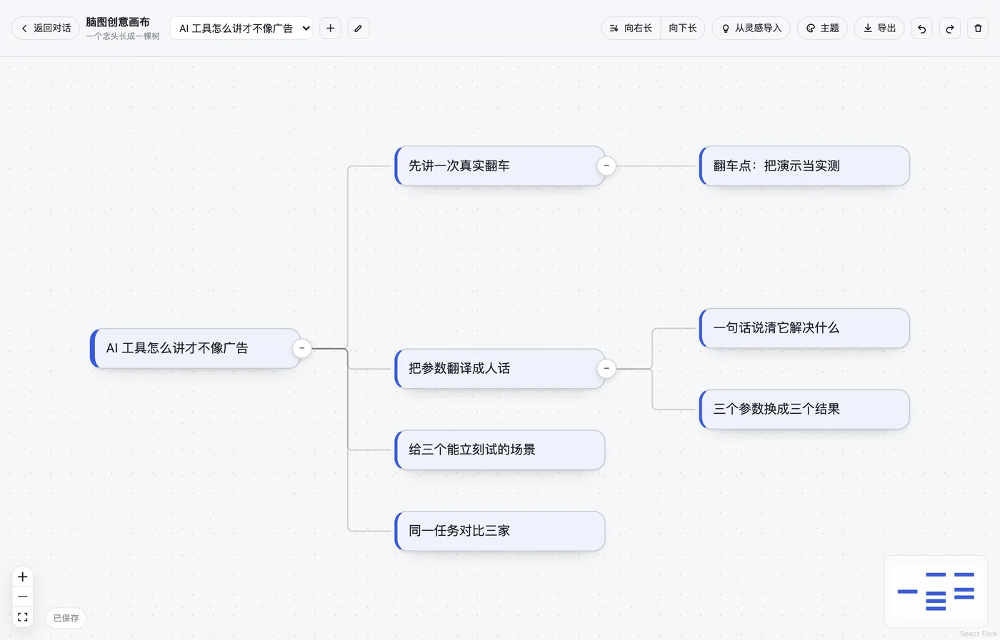

# dsh-plugins

[](./LICENSE)
[](https://github.com/deepseek-ai/deepseek-harness)
[](#plugin-catalog)
[](https://github.com/topics/dsh-plugin)

**English** · [简体中文](README.zh-CN.md)

**dsh-plugins is a collection of eleven open-source plugins for [DeepSeek Harness](https://github.com/deepseek-ai/deepseek-harness) (`dsh`) — the open-source agent harness built on the everything-is-a-plugin [Cordis](https://github.com/cordiverse/cordis) architecture — plus the self-hosted, machine-readable plugin market index that installs them.**

The plugins cover voice input and speech output, GitHub project management, session archiving with a PDCA self-improvement loop, skills and agent-instruction health checks, mind mapping, a local context library, an external task ledger, version update checks, and a full novel-writing pipeline. Each one is a standard DSH bundle: a Host half, an optional Web client half, and a `cordis.patch.yml` that wires it into the app.

- **One index URL, no build step.** Add the index in DSH's plugin market and install any of the eleven.
- **Local first.** Recognition, scanning, scoring and ledger data stay on the machine; the few features that call out are listed under [Privacy and data](#privacy-and-data).
- **MIT licensed.** Every plugin, including the index format, is in this repository.

**Docs site:** <https://feahter.github.io/dsh-plugins/> — the same catalog as a static landing page, with one anchor per plugin (`#novel-forge`, `#voice-companion`, …), an install block and an FAQ. Its plugin list, anchors and versions are checked against `index.json` by `docs/verify-readme.mjs`, so it never lists a plugin the market does not have.

## 中文导读

一个仓库收录十一个 [DeepSeek Harness](https://github.com/deepseek-ai/deepseek-harness)（DSH）插件，并自带一份可被插件市场直接读取的索引。在 DSH Web UI 的 **插件 → 发现** 里添加：

```
https://raw.githubusercontent.com/Feahter/dsh-plugins/main/index.json
```

即可搜索并安装全部插件。十一个插件分别覆盖：本地连续语音输入、语音看板娘（通话/听写/热键）、GitHub 项目管理、会话归档与 PDCA 炼金、技能与 Agents 说明书体检、无限画布脑图、本机上下文资源库、外置任务账本、版本更新检查、长篇小说流水线。**完整中文说明见 [README.zh-CN.md](README.zh-CN.md)。**

## Contents

- [Install](#install)
- [Plugin catalog](#plugin-catalog)
- [Plugins](#plugins)
- [Which plugin do I need?](#which-plugin-do-i-need)
- [Privacy and data](#privacy-and-data)
- [Compatibility](#compatibility)
- [FAQ](#faq)
- [The plugin index](#the-plugin-index)
- [Repository layout](#repository-layout)
- [Contributing](#contributing)
- [License](#license)

## Install

### From the plugin market (recommended)

1. Open the DSH Web UI and go to **Plugins → Discover** (or **Settings → Plugins → Discover**).
2. Add this index URL:

   ```
   https://raw.githubusercontent.com/Feahter/dsh-plugins/main/index.json
   ```

3. Search for a plugin by its market title (for example *Mind canvas* or *Task ledger*) and install it.

The index pins an exact commit for every published version, so the code you install is the code that was released — not whatever `main` happens to contain later.

### From the command line

Manual installs use the same commit as the index:

```bash
dsh plugin install "git+https://github.com/Feahter/dsh-plugins.git#<commit>&path:/plugins/realtime-voice"
dsh plugin install "git+https://github.com/Feahter/dsh-plugins.git#<commit>&path:/plugins/voice-companion"
dsh plugin install "git+https://github.com/Feahter/dsh-plugins.git#<commit>&path:/plugins/github-manager"
dsh plugin install "git+https://github.com/Feahter/dsh-plugins.git#<commit>&path:/plugins/archive-rsi"
dsh plugin install "git+https://github.com/Feahter/dsh-plugins.git#<commit>&path:/plugins/dsh-360"
dsh plugin install "git+https://github.com/Feahter/dsh-plugins.git#<commit>&path:/plugins/mind-canvas"
dsh plugin install "git+https://github.com/Feahter/dsh-plugins.git#<commit>&path:/plugins/context-lib"
dsh plugin install "git+https://github.com/Feahter/dsh-plugins.git#<commit>&path:/plugins/task-ledger"
dsh plugin install "git+https://github.com/Feahter/dsh-plugins.git#<commit>&path:/plugins/update-check"
dsh plugin install "git+https://github.com/Feahter/dsh-plugins.git#<commit>&path:/plugins/novel-forge"
```

Replace `<commit>` with the commit recorded for the version you want in [`index.json`](./index.json). For local development, point the plugin manager at a checkout of the corresponding `plugins/<name>` directory instead.

### Requirements at a glance

- DSH **`>=0.2.1-rc.4 <0.3.0-0`** — every plugin declares that exact range in `engines.dsh` (developer preview; breaking changes can happen between releases).
- Node **22.15** or newer — declared by all eleven packages; `archive-rsi` and `dsh-360` need it to decode concatenated-zstd session logs.
- macOS for the `context-lib` document previews (`textutil`, `qlmanage`); everything else on that plugin is cross-platform.
- The experimental **Voice input** bundle, a microphone, and a TTS provider on the Host for the two voice plugins.
- A configured model for `novel-forge` and for `mind-canvas`'s **AI branch**.
- `gh auth login` or `GH_TOKEN` / `GITHUB_TOKEN` for `github-manager`.

## Plugin catalog

Eleven plugins, grouped by what they are for. Nine are actively maintained; `voice-control` is retired and `realtime-voice` is superseded by Voice companion. The market title in brackets is the name shown in DSH Discover.

| Plugin | Category | What it does |
| --- | --- | --- |
| [Realtime voice input](./plugins/realtime-voice) | Voice | Continuous offline dictation: speak, and each sentence is cleaned up and written into the composer. Optional dictation translation. |
| [Voice companion](./plugins/voice-companion) | Voice | One panel for the whole voice surface: call mode, dictation, a global hold-to-talk hotkey, spoken task progress, and a switchable mascot with custom voice. |
| [Voice control](./plugins/voice-control) | Voice | Hold a key, speak, and the sentence is routed to the session it belongs to and the reply is spoken back. The router is one tested pure function that asks instead of guessing. |
| [GitHub project manager](./plugins/github-manager) | Developer tools | A sidebar GitHub panel plus `github_*` agent tools: repositories, branches, issues, pull requests, comments. Reuses your existing `gh` login. |
| [Session archive + PDCA alchemy](./plugins/archive-rsi) | Context engineering | Curate DSH session history (tags, notes, search, trash) and mine it for measurable context fixes with a PDCA loop. |
| [dsh-360](./plugins/dsh-360) | Context engineering | Two health checks in one panel: the skills catalog and everything injected into context (`AGENTS.md`, subagent definitions, agent presets). |
| [Mind canvas](./plugins/mind-canvas) | Creative | An infinite-canvas mind map in the sidebar: `Tab` to branch, tidy into a tree, AI-expand a node, export Markdown/OPML/FreeMind/JSON/PNG. |
| [Context library](./plugins/context-lib) | Context engineering | Indexes documents, code, images and session logs already on the machine into one searchable library with nine `context_lib_*` tools. |
| [Task ledger](./plugins/task-ledger) | Context engineering | Moves goals, decisions and evidence out of the transcript into an external ledger, so a task resumes after any session ends. |
| [Version update check](./plugins/update-check) | Developer tools | Shows the installed DSH version, the newest version on your update feed, and hands the upgrade to the in-app updater. |
| [Ink Furnace — novel forge](./plugins/novel-forge) | Creative | Premise to finished novel: world bible, characters, outline, beats, prose, continuity review, revision, Markdown/EPUB export. |

`plugins/voice-control` is retired: its hotkey moved into **Voice companion**, and it should not be enabled alongside it.

## Plugins

### [Realtime voice input](./plugins/realtime-voice)

Continuous dictation for the composer. Click the microphone once, speak, and each paused sentence is written into the input box. Recognition runs on the local CPU with SenseVoiceSmall (ONNX, int8), so audio never leaves the device.

- **Sentence cleanup, offline.** Fillers are removed, repeated words merged, self-corrections followed ("no, I mean…"), punctuation and casing normalized. No model tokens are spent.
- **Paired-sentence correction.** Neighbouring sentences are polished together, so a misplaced pause or a half-corrected sentence does not get inserted as-is.
- **Optional dictation translation.** In `translate` mode, a spoken Chinese sentence is written in English (or another target language). If translation is unavailable it falls back to the original text and says so.
- **Reusable service.** Exposes `ctx.get('voiceInput')` with `attach/start/stop/toggle/settings`, so other input surfaces can reuse the audio stack.
- **One microphone.** Registers at `conversation.input.activity` with `priority: -1`, replacing the built-in dictation button instead of sitting next to it.

*Requirements:* DSH ≥ 0.2.1-rc.4 with the experimental **Voice input** bundle enabled (it provides the local SenseVoice recognizer and the `speech` Host Remote), plus a microphone. Only translation mode sends the sentence text to your translation provider.

### [Voice companion](./plugins/voice-companion)

One panel that covers the whole voice surface: **call mode** (energy VAD plus sentence splitting; replies are spoken sentence by sentence and task progress is read back), **composer dictation** (filler words polished, written into the input box), and a **global hotkey** (`Ctrl+Shift+Space`: hold to talk, release to plan and send).

- **A stage, not a status bar.** The default is a self-drawn 3D core (SDF ray-marched WebGL2/GLSL, no three.js, no textures, no network), with two original inline-SVG mascots (a whale and an anime stand-in) still switchable; the panel drags anywhere and folds into a pill when it is in the way.
- **Voice that matches the sentence.** TTS voice and tone are chosen per character and per sentence mood, so an apology comes out soft and good news comes out bright.
- **Custom avatar and voice.** Use your own image as the character, pick from three voice slots, and adjust speaking rate without editing config files.
- **Absorbs two earlier plugins.** The dictation half of `dsh-realtime-voice` and the hotkey of `dsh-voice-control` now live here.

*Requirements:* DSH ≥ 0.2.1-rc.4 with the experimental **Voice input** bundle, a microphone, and a TTS provider on the Host for `/speak`. Routes: under `/api/voice-companion`: `GET /health`, `/characters`, `/events`; `POST /turn`, `/speak`, `/dispatch`, `/transcribe`, `/plan`, `/send`.

### [GitHub project manager](./plugins/github-manager)

A sidebar GitHub panel and a family of `github_*` agent tools: browse repositories and branches, triage issues, inspect pull requests, create or close issues, and comment — from the Web UI or from chat.

- **Credentials stay on the Host.** Tokens are resolved from your existing `gh auth login` (including the macOS keyring) or from `GH_TOKEN` / `GITHUB_TOKEN`; the token never reaches the browser.
- **Chat and panel share one implementation,** so an issue created from a tool call shows up in the panel without a refresh dance.

*Requirements:* DSH ≥ 0.2.1-rc.4, a GitHub account, and `gh auth login` or a token with `repo` scope. GitHub API calls go to github.com; nothing else leaves the machine.

### [Session archive + PDCA alchemy](./plugins/archive-rsi)

Two layers over the Harness's own session history.

- **Archive curation.** One `session_archive` tool (`action`: sync, list, read, update, autotag, delete) adds what the Harness lacks — tags, notes, search, trash — over `~/.dsh/sessions`. The Harness's own archive/pin state is mirrored read-only rather than forked, and original session files are never modified, moved or deleted.
- **PDCA over the corpus.** `rsi` (`action`: plan, run, status) computes tool-error rate, correction rate, the edit-then-no-verification gap, context pressure and tool-catalog cost and turns the outliers into findings carrying `sessionId + seq` evidence; `rsi_apply` (`action`: act, adopt) emits context patches (prompt lessons, `AGENTS.md` rules, skill candidates) and applies or reverts one. Observations that cannot become an adoptable patch stay findings instead of unadoptable proposals.
- **Adopt, then measure again.** A patch can be adopted and later re-evaluated against the sessions on both sides of the adoption. The boot-time run now does that re-measurement itself (`autoEvaluate`), so the loop — observe, patch the context, measure again — closes without anyone remembering to ask. That is tool-layer recursive self-improvement.

*Requirements:* DSH ≥ 0.2.1-rc.4 and Node ≥ 22.15 (session logs are concatenated-zstd containers decoded through `node:zlib`). Data lives in `~/.dsh/archive-rsi/`. All computation is local and calls no LLM.

### [dsh-360](./plugins/dsh-360)

One plugin, two health-check surfaces, one sidebar panel with two tabs and one shared **18-bucket S~E grade scale** (S+/S/S−/A+/A/A−/…/E−).

- **Skills surface.** Scores each catalog entry's on-demand loading path: catalog selectability, real load evidence, trigger uniqueness, progressive disclosure, actionability, boundaries, hygiene, evolution.
- **Agents surface.** Scores everything that gets injected — instruction files (`AGENTS.md` / `CLAUDE.md`), subagent definitions and agent presets: injection hit rate, resident token cost, layering, imperative rules with verification commands, scope and cross-file conflicts, hygiene, evolution.
- **Classification and a meta-skill layer.** A four-axis classification (role / kind / scope / state) plus a skills-only split between meta skills and task skills.
- **Snapshot-first panel.** The last scan paints before revalidation; filters collapse behind one icon; optimization-effect cards show what changed and offer a real undo. v0.2 scans about 3× faster.

*Requirements:* DSH ≥ 0.2.1-rc.4 and Node ≥ 22.15 (session-log evidence is read from concatenated-zstd logs). Supersedes `skills-360` + `agents-360` — do not enable them side by side. Data lives in `~/.dsh/dsh-360/`. Four `dsh360_*` tools take a `surface` parameter (`skills` / `agents` / `both`); every write is backed up and undoable.

### [Mind canvas](./plugins/mind-canvas)

A mind map on an infinite canvas inside the sidebar. Jot a thought and press Enter for the first node; `Tab` grows a child and drops straight into editing; `⌘Z` undoes; deleting a node takes its whole subtree.



- **Tidy tree layouts.** `Tidy up` runs a d3-hierarchy tidy tree so siblings never overlap, growing right or down; any node can collapse its subtree.
- **Themes.** Five presets (paper / midnight / forest / sunset / indigo) plus a custom palette of 13 colour slots; `Follow app` inherits the host's light and dark tokens, and all 14 colour pairs pass WCAG 4.5:1.
- **Import and AI branch.** **From inspirations** imports entries from the Media desk plugin as roots; **AI branch** asks the host's default model for 3–6 concrete child ideas, failing loudly instead of inventing content when no model is configured.
- **Export.** Markdown outline, OPML (XMind / MindNode), FreeMind `.mm`, raw JSON and PNG. Markdown has exactly one implementation, shared by the UI export and the `mind_canvas_read` tool.
- **Agent tools.** `mind_canvas_read` (outline + stats) and `mind_canvas_add` (branch a node by text match).

*Requirements:* DSH ≥ 0.2.1-rc.4. Data lives in `~/.dsh/mind-canvas/state.json`; the host half has zero runtime dependencies.

### [Context library](./plugins/context-lib)

One searchable index of what is already on this machine — Markdown notes, code, images, PDFs, Office files, session logs — plus the agent tools to use it as context.

- **Sources are directories.** Scans respect a depth cap and an extension whitelist, register files by size and mtime so rescans are incremental, and only ever describe linked files — never move or delete them.
- **Panel for the human half.** Search, type/collection/tag filters, detail view with editing, notes, trash and restore, and four view modes (list, cards, table, gallery).
- **Local previews, no parser zoo.** `textutil` converts doc/docx/rtf/odt, `qlmanage` renders pdf/xlsx/ppt thumbnails (cached by file + size + mtime), and HTML is stripped to text.

*Requirements:* DSH ≥ 0.2.1-rc.4; macOS for the `textutil` / `qlmanage` previews. Data lives in `~/.dsh/context-lib/` (`index.json`, `notes/`, `blobs/`, `cache/thumbs/`). Tools: `context_lib_search`, `read`, `put`, `update`, `delete`, `scan`, `stats`, `sources`, `pack`; a short library briefing is injected every turn.

### [Task ledger](./plugins/task-ledger)

State that outlives the session. Goals, decisions, evidence and next actions are written to an external ledger (`~/.dsh/task-ledger/`) instead of the transcript, so a task survives closing every conversation, switching model or switching agent: hand back the `task_id` and it resumes from the ledger.

- **Five tools.** `task_list`, `task_open`, `task_resume` (takes the single-writer lease and returns a `run_id`), `task_checkpoint` (evidence, claims, decisions, next actions, optimistic `expected_version`) and `task_close`.
- **Evidence gate.** Every run closes with `task_close`; a failing gate downgrades `done` to `blocked` unless the override is recorded as a decision.
- **A panel that reads the ledger directly,** rather than a second copy of it.

*Requirements:* DSH ≥ 0.2.1-rc.4. A failed ledger write is reported in the run report, never silently swallowed.

### [Version update check](./plugins/update-check)

A sidebar panel that answers "what am I running, and is there anything newer?"

- **The installed version is read from the app bundle itself** (Info.plist / packaged manifest, not guessed); the newest version comes from your update source (the same `app-update.yml` electron-updater uses).
- **One button hands the upgrade to the in-app updater:** download, verify, confirm restart.
- **Degrades honestly.** The page never shells out and never replaces a signed `.app`; in a plain browser with no preload bridge, it says so and turns the button into a download link.

*Requirements:* DSH ≥ 0.2.1-rc.4.

### [Ink Furnace — novel forge](./plugins/novel-forge)

One premise in, a finished novel out: premise → world bible → characters → emotional spine → outline → per-chapter beats → prose → continuity review → revision → Markdown/EPUB.

- **A generic stage engine.** The novel recipe drives a stage engine that does not know what a novel is, so every stage is resumable per item and a run can be stopped and continued at chapter granularity.
- **Continuity review that survives bad JSON.** Findings are salvaged instead of discarded, summaries are written in the same call as the prose they belong to (78 → 54 calls and −27% input on a 12 × 3000-word book), and failed attempts are still counted in the run's real cost.
- **Pronouns tracked per character,** so a female lead is never rewritten as "him".

*Requirements:* DSH ≥ 0.2.1-rc.4 and a configured model — a missing key fails fast with a config hint instead of retrying three times. Data lives in `~/.dsh/novel-forge/`; projects export to Markdown or EPUB.

## Which plugin do I need?

| If you want to… | Install |
| --- | --- |
| Dictate instead of typing, offline | [Realtime voice input](./plugins/realtime-voice) |
| Talk to the agent, hear replies, and keep a mascot on screen | [Voice companion](./plugins/voice-companion) |
| Browse repositories and triage issues without leaving DSH | [GitHub project manager](./plugins/github-manager) |
| Find out where your sessions lose time, and fix the context | [Session archive + PDCA alchemy](./plugins/archive-rsi) |
| See whether your skills and `AGENTS.md` are actually loaded and read | [dsh-360](./plugins/dsh-360) |
| Think in a tree and export it to XMind or Markdown | [Mind canvas](./plugins/mind-canvas) |
| Make the files already on disk searchable for the agent | [Context library](./plugins/context-lib) |
| Keep a long task alive across sessions and models | [Task ledger](./plugins/task-ledger) |
| Know whether your DSH install is current | [Version update check](./plugins/update-check) |
| Write a long novel with continuity checks | [Ink Furnace — novel forge](./plugins/novel-forge) |

## Privacy and data

Everything that can run locally does. This table is the complete list of exceptions:

| Plugin | Leaves the machine |
| --- | --- |
| Realtime voice input | Nothing by default. Only `translate` mode sends that sentence's text to your translation provider. |
| Voice companion | Speech recognition is local; the reply text goes to your TTS provider for `/speak`, and the theme designer sends one sentence to your model (`POST /theme/design`). |
| GitHub project manager | GitHub API calls only, made from the Host with your token. |
| Session archive + PDCA alchemy | Nothing. All metrics are computed locally from session logs. |
| dsh-360 | Nothing. Signals are read from local session logs. |
| Mind canvas | Nothing, except the prompt sent to your default model when you use **AI branch**. |
| Context library | Nothing. Index, notes and thumbnails live under `~/.dsh/context-lib/`. |
| Task ledger | Nothing. The ledger is a directory on disk. |
| Version update check | Reads your configured update feed to compare versions. |
| Ink Furnace — novel forge | Prompts and prose go to your configured model provider. |

Original session files and scanned documents are never modified, moved or deleted by any plugin in this repository.

## Compatibility

- **DSH version.** All eleven plugins require DSH `>=0.2.1-rc.4 <0.3.0-0`; a newer major line needs its own `engines` update and release. DSH is in developer preview, so pin the version you install and read the release notes before upgrading.
- **Node.** `archive-rsi` and `dsh-360` need Node `22.15+` to decode concatenated-zstd session logs.
- **Platform.** macOS is required only for `context-lib` previews; the other ten plugins make no platform-specific calls.
- **Optional capabilities.** The voice plugins need the experimental Voice input bundle and a microphone; `voice-companion` and `novel-forge` need a TTS provider or a configured model respectively.
- **Superseded packages.** The standalone `realtime-voice` dictation is folded into `voice-companion`; `skills-360` and `agents-360` are folded into `dsh-360`. `voice-control` is published again as its own plugin (0.1.0) focused on routing a spoken sentence to the right session; it and `voice-companion` both bind `Ctrl+Shift+Space`, so enable one of the two, not both.

## FAQ

**What is DeepSeek Harness?**
DeepSeek Harness (`dsh`) is an open-source agent harness from DeepSeek AI, built on an everything-is-a-plugin architecture powered by Cordis. It runs as a local Web UI / desktop app, and plugins add panels, tools and services to it.

**What is dsh-plugins?**
A repository of eleven DSH plugins plus a self-hosted format-1 plugin market index (`index.json`). Adding the index URL to DSH Discover makes all eleven installable with one click.

**Are these official DeepSeek plugins?**
No. dsh-plugins is an independent community project maintained by [Feahter](https://github.com/Feahter). It targets the public DSH plugin API and is not published or endorsed by DeepSeek.

**How do I install a plugin?**
Open **Plugins → Discover** in DSH, add `https://raw.githubusercontent.com/Feahter/dsh-plugins/main/index.json`, then search for the market title. Command-line installs are listed under [Install](#install).

**Do the plugins send my data anywhere?**
Almost never. Recognition, session analysis, scoring, indexing and the ledger are local. The complete exception list is the [Privacy and data](#privacy-and-data) table — translation, TTS, model calls and the GitHub API.

**Do I need an API key?**
Only for the features that call a model: `novel-forge`, `mind-canvas`'s AI branch, `realtime-voice` translation and `voice-companion` TTS. Everything else runs without one.

**Which plugin should I install first?**
If you want to stop typing, start with **Realtime voice input**; if you want the agent's state to survive sessions, start with **Task ledger**. The [use-case table](#which-plugin-do-i-need) maps goals to plugins.

**Where is plugin data stored?**
Under `~/.dsh/<plugin>/`. Each plugin's section above names its directory; nothing is written into the DSH app bundle.

**Can I host my own index?**
Yes. The format is documented by the index itself — copy [`index.json`](./index.json), change the plugins and versions, and serve it from any URL DSH can reach.

**Why do some plugins say "experimental"?**
The voice plugins depend on DSH's experimental Voice input bundle. The label marks that dependency, not instability in the plugin's own code.

## The plugin index

[`index.json`](./index.json) is a format-1 DSH plugin market index. It is both the file DSH Discover reads and a machine-readable description of this repository that other tools and agents can parse:

```json
{
  "name": "dsh-mind-canvas",
  "title": { "en": "Mind canvas", "zh": "脑图创意画布" },
  "description": { "en": "…", "zh": "…" },
  "metadata": { "category": "creative", "keywords": ["mindmap", "canvas", "opml"] },
  "versions": [{ "version": "0.3.0", "source": { "commit": "…", "path": "plugins/mind-canvas" } }]
}
```

It carries bilingual titles and descriptions, categories, keywords, and an exact commit per version. If you are an agent or a script looking for DSH plugins, `index.json` is the canonical list; this README is the human-readable companion.

## Repository layout

```
dsh-plugins/
├── index.json           # format-1 plugin market index (bilingual titles, pinned commits)
├── README.md            # this file (English)
├── README.zh-CN.md      # 简体中文说明
├── llms.txt             # compact machine-readable summary for AI assistants
├── docs/                # SEO/GEO checklist + README consistency check
├── LICENSE              # MIT
└── plugins/
    ├── realtime-voice/  # offline dictation
    ├── voice-companion/ # call mode + dictation + hotkey + mascot
    ├── github-manager/  # sidebar panel + github_* tools
    ├── archive-rsi/     # session archive + PDCA
    ├── dsh-360/         # skills / agents health checks
    ├── mind-canvas/     # infinite-canvas mind map
    ├── context-lib/     # local context library
    ├── task-ledger/     # external task ledger
    ├── update-check/    # version update panel
    └── novel-forge/     # novel writing pipeline
```

Each plugin directory is a standard DSH bundle: `package.json`, `cordis.patch.yml`, a Host half (`index.js`), usually a compiled Web client (`client.js`), optional `locale/` and a README with the details.

## Contributing

Issues and pull requests are welcome. A plugin PR should include: a `package.json` with `engines.dsh`, a `cordis.patch.yml`, a README that states requirements and data paths, and an entry in `index.json` with a pinned commit. Run the plugin's own tests before opening the PR.

If you build a DSH plugin somewhere else, add the [`dsh-plugin`](https://github.com/topics/dsh-plugin) topic to your repository so it can be found. For a docs change, run `node docs/verify-readme.mjs` first — it checks that every relative link and anchor resolves and that all eleven plugins appear in `index.json`, `llms.txt` and both READMEs.

## License

MIT — see [LICENSE](./LICENSE).

## Citation

If you reference this collection in a paper, post or agent response:

```bibtex
@misc{dsh-plugins2026,
  title  = {dsh-plugins: open-source plugins and a market index for DeepSeek Harness},
  author = {Feahter},
  year   = {2026},
  url    = {https://github.com/Feahter/dsh-plugins}
}
```

Machine-readable form: [`CITATION.cff`](./CITATION.cff) (GitHub renders a "Cite this repository" button from it).
