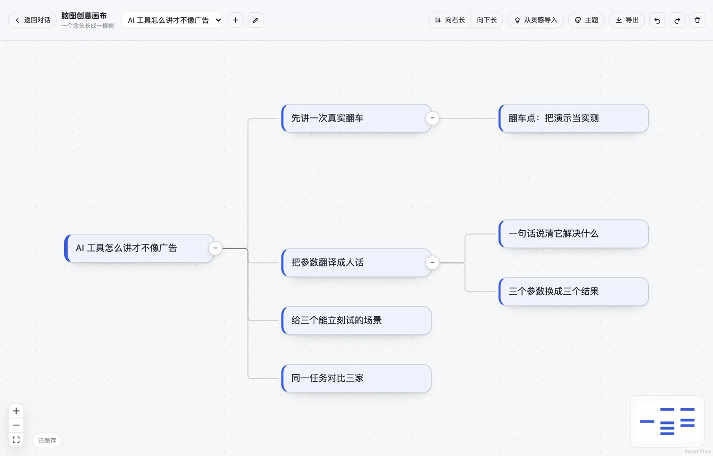

# dsh-plugins

[](./LICENSE)
[](https://github.com/deepseek-ai/deepseek-harness)
[](#插件目录)
[](https://github.com/topics/dsh-plugin)

[English](README.md) · **简体中文**

**dsh-plugins 是一个 [DeepSeek Harness](https://github.com/deepseek-ai/deepseek-harness)（简称 DSH）的开源插件合集，收录十一个插件，并自带一份可自托管、机器可读的插件市场索引。** DSH 是 DeepSeek AI 开源、以「一切皆插件」的 [Cordis](https://github.com/cordiverse/cordis) 架构搭建的 agent 运行框架。

十一个插件覆盖：实时语音输入与语音播报、GitHub 项目管理、会话归档与 PDCA 自我改进、技能与说明书体检、脑图创意画布、本机上下文资源库、外置任务账本、版本更新检查、长篇小说流水线、按会话路由的语音控制。每个插件都是标准 DSH bundle：一个 Host 半边、一个可选的 Web client 半边，以及把它们接入应用的 `cordis.patch.yml`。

- **一个索引地址，无需构建。** 在 DSH 插件市场里添加下面的索引，十一个插件都能装。
- **本地优先。** 识别、扫描、评分、账本都在本机完成；少数必须外发的功能全部列在「隐私与数据」一节。
- **MIT 许可。** 十一个插件与索引格式都在这个仓库里。

## 目录

- [安装](#安装)
- [插件目录](#插件目录)
- [插件详解](#插件详解)
- [我该装哪个？](#我该装哪个)
- [隐私与数据](#隐私与数据)
- [兼容性](#兼容性)
- [常见问题](#常见问题)
- [插件索引](#插件索引)
- [仓库结构](#仓库结构)
- [参与贡献](#参与贡献)
- [许可证](#许可证)

## 安装

### 从插件市场安装（推荐）

1. 打开 DSH Web UI，进入 **插件 → 发现**（或 **设置 → 插件 → 发现**）。
2. 添加索引地址：

   ```
   https://raw.githubusercontent.com/Feahter/dsh-plugins/main/index.json
   ```

3. 按市场标题搜索（例如「脑图创意画布」「任务账本」）并安装。

索引为每个已发布版本钉死了具体 commit，所以你装到的代码就是当初发布的代码，而不是 `main` 之后偶然变成的样子。

### 从命令行安装

手动安装使用与索引相同的 commit：

```bash
dsh plugin install "git+https://github.com/Feahter/dsh-plugins.git#<commit>&path:/plugins/realtime-voice"
dsh plugin install "git+https://github.com/Feahter/dsh-plugins.git#<commit>&path:/plugins/voice-companion"
dsh plugin install "git+https://github.com/Feahter/dsh-plugins.git#<commit>&path:/plugins/github-manager"
dsh plugin install "git+https://github.com/Feahter/dsh-plugins.git#<commit>&path:/plugins/archive-rsi"
dsh plugin install "git+https://github.com/Feahter/dsh-plugins.git#<commit>&path:/plugins/dsh-360"
dsh plugin install "git+https://github.com/Feahter/dsh-plugins.git#<commit>&path:/plugins/mind-canvas"
dsh plugin install "git+https://github.com/Feahter/dsh-plugins.git#<commit>&path:/plugins/context-lib"
dsh plugin install "git+https://github.com/Feahter/dsh-plugins.git#<commit>&path:/plugins/task-ledger"
dsh plugin install "git+https://github.com/Feahter/dsh-plugins.git#<commit>&path:/plugins/update-check"
dsh plugin install "git+https://github.com/Feahter/dsh-plugins.git#<commit>&path:/plugins/novel-forge"
```

把 `<commit>` 换成 [`index.json`](./index.json) 中该版本记录的 commit。本地开发时，让插件管理器指向你本地 checkout 的 `plugins/<名称>` 目录即可。

### 环境要求一览

- DSH **0.2.1-rc.4** 或更新版本（开发者预览期，版本之间可能有破坏性变更）。
- Node **22.15** 或更新版本——仅两个需要解码会话日志的插件（`archive-rsi`、`dsh-360`）要求。
- macOS 用于 `context-lib` 的文档预览（`textutil`、`qlmanage`），该插件其余功能跨平台。
- 实验性的 **Voice input** bundle、一个麦克风，以及 Host 端的 TTS 服务，用于两个语音插件。
- 已配置模型，用于 `novel-forge` 与 `mind-canvas` 的 **AI 分支**。
- `gh auth login` 或 `GH_TOKEN` / `GITHUB_TOKEN`，用于 `github-manager`。

## 插件目录

十一个在维护的插件，按用途分组。括号里是 DSH 发现页显示的市场标题。

| 插件 | 分类 | 作用 |
| --- | --- | --- |
| [实时语音输入](./plugins/realtime-voice) | 语音 | 连续的离线听写：说话，每句话整理后写进输入框。可选听写翻译。 |
| [语音看板娘](./plugins/voice-companion) | 语音 | 一个面板覆盖整个语音面：通话模式、听写、全局按住说话热键、朗读任务进度、可切换形象与自定义音色。 |
| [语音控制](./plugins/voice-control) | 语音 | 按住一个键说话，话被送进「该去的那个 Session」，回复用语音播回。路由是一个 17 个单测覆盖的纯函数：没把握就问，不猜。 |
| [GitHub 项目管理](./plugins/github-manager) | 开发者工具 | 侧栏 GitHub 面板加 `github_*` agent 工具：仓库、分支、issue、PR、评论。复用你已有的 `gh` 登录。 |
| [归档会话与 PDCA 炼金](./plugins/archive-rsi) | 上下文工程 | 整理 DSH 会话历史（标签、笔记、搜索、回收站），并用 PDCA 循环从中挖出可度量的上下文修复。 |
| [dsh-360](./plugins/dsh-360) | 上下文工程 | 一个面板两面体检：技能目录，以及一切被注入上下文的内容（`AGENTS.md`、子代理定义、agent 预设）。 |
| [脑图创意画布](./plugins/mind-canvas) | 创意 | 侧栏里的无限画布脑图：`Tab` 长出分支、一键整理成树、AI 扩写节点、导出 Markdown/OPML/FreeMind/JSON/PNG。 |
| [上下文资源库](./plugins/context-lib) | 上下文工程 | 把本机已有的文档、代码、图片、会话日志索引成一个可检索的库，配九个 `context_lib_*` 工具。 |
| [任务账本](./plugins/task-ledger) | 上下文工程 | 把目标、决策、证据从对话里搬到外置账本，任务跨会话、跨模型都能接着做。 |
| [版本更新检查](./plugins/update-check) | 开发者工具 | 显示已装 DSH 版本、更新源上的最新版本，并把升级交给应用内更新器。 |
| [墨炉 · 小说炼炉](./plugins/novel-forge) | 创意 | 从设定到成书：世界观、人物、大纲、节拍、正文、连贯性审校、修订、导出 Markdown/EPUB。 |

`plugins/voice-control` 已退役：它的热键并入了**语音看板娘**，两者不要同时启用。

## 插件详解

### [实时语音输入](./plugins/realtime-voice)

给输入框的连续听写。点一下麦克风，开始说话，每停顿一句就整理成文字写进输入框。识别在本机 CPU 上跑 SenseVoiceSmall（ONNX，int8），音频不出设备。

- **离线断句整理。** 去掉语气词、合并重复词、跟随自我更正（「不对，我是说……」）、规范化标点与大小写。不消耗模型 token。
- **成对润色。** 相邻两句一起修，避免因为停顿位置不对或只改了一半，把半成品句子写进去。
- **可选听写翻译。** `translate` 模式下，说出中文、写入英文（或其他目标语言）。翻译不可用时回退到原文并明确提示。
- **可复用的服务。** 暴露 `ctx.get('voiceInput')`，含 `attach/start/stop/toggle/settings`，其他输入面可以复用这套音频栈。
- **只留一个麦克风。** 在 `conversation.input.activity` 以 `priority: -1` 注册，替换内置听写按钮而不是与它并列。

*要求：* DSH ≥ 0.2.1-rc.4 且启用实验性的 **Voice input** bundle（它提供本地 SenseVoice 识别器与 `speech` Host Remote），以及一个麦克风。只有翻译模式会把该句文本发往你的翻译服务。

### [语音看板娘](./plugins/voice-companion)

一个面板覆盖所有语音交互：**通话模式**（能量 VAD 加断句，回复逐句朗读，任务进度也会念出来）、**输入框听写**（润色语气词后写入输入框）、**全局热键**（`Ctrl+Shift+Space`：按住说话，松开规划并发送）。

- **是形象，不是状态条。** 原创内联 SVG 角色——一只鲸鱼和一个二次元替身——可在面板切换；面板可拖到任意位置，挡路时折叠成一颗胶囊。
- **音色跟着语气走。** TTS 音色与语气按角色、按每句的情绪选择，道歉听起来轻，好消息听起来亮。
- **自定义形象与音色。** 用自己的图片当角色，从三个音色槽里挑，调整语速，不用改配置文件。
- **吞并了两个旧插件。** `dsh-realtime-voice` 的听写半边与 `dsh-voice-control` 的热键，现在都在这里。

*要求：* DSH ≥ 0.2.1-rc.4 且启用实验性的 **Voice input** bundle、一个麦克风，以及 Host 端供 `/speak` 使用的 TTS 服务。路由：均在 `/api/voice-companion` 下：`GET /health`、`/characters`、`/events`；`POST /turn`、`/speak`、`/dispatch`、`/transcribe`、`/plan`、`/send`。

### [GitHub 项目管理](./plugins/github-manager)

一个侧栏 GitHub 面板，加一族 `github_*` agent 工具：浏览仓库与分支、处理 issue、查看 PR、创建或关闭 issue、发评论——在 Web UI 里或对话里都行。

- **凭据留在 Host 端。** token 从你已有的 `gh auth login`（包括 macOS 钥匙串）或 `GH_TOKEN` / `GITHUB_TOKEN` 解析，永远不会到达浏览器。
- **对话与面板共用一套实现，** 从工具调用创建的 issue 会直接出现在面板里，不用刷新。

*要求：* DSH ≥ 0.2.1-rc.4、一个 GitHub 账号，以及 `gh auth login` 或带 `repo` 权限的 token。GitHub API 调用发往 github.com，除此之外不出本机。

### [归档会话与 PDCA 炼金](./plugins/archive-rsi)

在 Harness 自带的会话历史之上加了两层。

- **归档整理。** `archive_*` 工具补上 Harness 缺的能力——在 `~/.dsh/sessions` 上同步、打标签、写笔记、读取、移入回收站、删除。Harness 自己的归档/置顶状态是只读镜像而不是分叉，原始会话文件永不被修改、移动或删除。
- **在语料上跑 PDCA。** `rsi_*` 工具计算工具错误率、纠错率、「改了没验证」的缺口、上下文压力和工具目录成本，把异常值变成带 `sessionId + seq` 证据的发现，并产出上下文补丁（prompt 教训、`AGENTS.md` 规则、技能候选项）。
- **采纳，然后再量一次。** 补丁可被采纳，之后用采纳之后产生的会话重新评估。这个「观察 → 改上下文 → 再观察」的闭环，就是工具层的递归自我改进。

*要求：* DSH ≥ 0.2.1-rc.4 与 Node ≥ 22.15（会话日志是拼接的 zstd 容器，通过 `node:zlib` 解码）。数据在 `~/.dsh/archive-rsi/`。全部计算都在本地，不调用任何 LLM。

### [dsh-360](./plugins/dsh-360)

一个插件、两面体检、一个双页签侧栏面板，共用一把 **18 档 S~E 评分尺**（S+/S/S−/A+/A/A−/…/E−）。

- **技能面。** 逐条评技能目录的按需加载链路：目录可选性、真实加载证据、触发唯一性、渐进披露、可执行性、边界、卫生、演化。
- **说明书面。** 评一切被注入的东西——指令文件（`AGENTS.md` / `CLAUDE.md`）、子代理定义、agent 预设：注入命中率、常驻 token 成本、分层、带验证命令的祈使规则、范围与跨文件冲突、卫生、演化。
- **分类与元技能层。** 四轴分类（角色 / 类型 / 范围 / 状态），外加仅技能面适用的「元技能 vs 任务技能」切分。
- **快照优先的面板。** 上次扫描结果先上屏再重新校验；筛选收进一个图标；优化效果卡片说明改了什么，并提供真正的撤销。v0.2 扫描快约 3 倍。

*要求：* DSH ≥ 0.2.1-rc.4 与 Node ≥ 22.15（会话日志证据从拼接 zstd 日志读取）。取代 `skills-360` + `agents-360`——不要同时启用。数据在 `~/.dsh/dsh-360/`。四个 `dsh360_*` 工具都接 `surface` 参数（`skills` / `agents` / `both`）；每次写入都有备份、可撤销。

### [脑图创意画布](./plugins/mind-canvas)

侧栏里一张无限画布脑图。写下一个念头回车出第一个节点，`Tab` 长出子节点并直接进入编辑，`⌘Z` 撤销，删除一个节点会连整棵子树一起删。



- **整洁的树状布局。** 「整理」用 d3-hierarchy 的 tidy tree，兄弟节点永不重叠，向右或向下生长；任意节点可折叠子树。
- **主题。** 五套预设（paper / midnight / forest / sunset / indigo），外加 13 个色槽的自定义配色；「跟随应用」继承宿主的明暗令牌，14 组配色都过 WCAG 4.5:1。
- **导入与 AI 分支。** 「从灵感导入」把 Media desk 插件的条目导入为根节点；「AI 分支」向宿主默认模型要 3–6 条具体子想法，没配模型时明确失败，而不是编内容。
- **导出。** Markdown 大纲、OPML（XMind / MindNode）、FreeMind `.mm`、原始 JSON、PNG。Markdown 只有一份实现，UI 导出与 `mind_canvas_read` 工具共用。
- **Agent 工具。** `mind_canvas_read`（大纲 + 统计）与 `mind_canvas_add`（按文本匹配给节点加分支）。

*要求：* DSH ≥ 0.2.1-rc.4。数据在 `~/.dsh/mind-canvas/state.json`；Host 半边零运行时依赖。

### [上下文资源库](./plugins/context-lib)

把本机已有的东西——Markdown 笔记、代码、图片、PDF、Office 文件、会话日志——索引成一个可检索的库，并提供把它当上下文用的 agent 工具。

- **来源就是目录。** 扫描有深度上限与扩展名白名单，按大小与 mtime 登记，重扫是增量的；只描述被链接的文件，从不移动或删除它。
- **给人用的面板。** 搜索、类型/归类/标签筛选、可编辑的详情视图、笔记、回收站与恢复，四种视图（列表、卡片、表格、画廊）。
- **本地预览，不堆解析器。** `textutil` 转换 doc/docx/rtf/odt，`qlmanage` 渲染 pdf/xlsx/ppt 缩略图（按文件 + 大小 + mtime 缓存），HTML 剥成纯文本。

*要求：* DSH ≥ 0.2.1-rc.4；`textutil` / `qlmanage` 预览需要 macOS。数据在 `~/.dsh/context-lib/`（`index.json`、`notes/`、`blobs/`、`cache/thumbs/`）。工具：`context_lib_search`、`read`、`put`、`update`、`delete`、`scan`、`stats`、`sources`、`pack`；每轮会注入一段简短的资源库提要。

### [任务账本](./plugins/task-ledger)

比会话活得更久的状态。目标、决策、证据与下一步被写进外置账本（`~/.dsh/task-ledger/`）而不是对话记录，所以任务在关掉每个对话、换模型、换 agent 之后依然存在：把 `task_id` 交回来，它就接着做。

- **五个工具。** `task_list`、`task_open`、`task_resume`（取单写者租约并返回 `run_id`）、`task_checkpoint`（证据、断言、决策、下一步、乐观锁 `expected_version`）、`task_close`。
- **证据门。** 每次运行都以 `task_close` 收尾；门没过时 `done` 会降级成 `blocked`，除非把覆盖写成一条决策。
- **面板直接读账本，** 而不是维护第二份拷贝。

*要求：* DSH ≥ 0.2.1-rc.4。账本写入失败会在运行报告里说明，绝不静默吞掉。

### [版本更新检查](./plugins/update-check)

一个回答「我现在跑的是哪版、有没有更新的」的侧栏面板。

- **已装版本从应用包本身读取**（Info.plist / 打包清单，不靠猜）；最新版本来自你的更新源（electron-updater 用的同一份 `app-update.yml`）。
- **一个按钮把升级交给应用内更新器：** 下载、校验、确认重启。
- **降级得很诚实。** 这个页面从不调用 shell，也从不替换已签名的 `.app`；在没有 preload 桥的普通浏览器里，它会说明情况并把按钮变成下载链接。

*要求：* DSH ≥ 0.2.1-rc.4。

### [墨炉 · 小说炼炉](./plugins/novel-forge)

一个设定进去，一本小说出来：设定 → 世界观 → 人物 → 情感主线 → 大纲 → 逐章节拍 → 正文 → 连贯性审校 → 修订 → 导出 Markdown/EPUB。

- **通用的阶段引擎。** 小说配方驱动一个并不知道「小说」为何物的阶段引擎，因此每个阶段都能按条目续跑，一次运行可以按章粒度停下再继续。
- **连坏 JSON 都能救回来的连贯性审校。** 发现项被抢救而不是丢弃；摘要与它所属的正文在同一次调用里写出（一本 12 × 3000 词的书从 78 次调用降到 54 次、输入 −27%）；失败尝试仍然计入运行的真实成本。
- **按人物跟踪代词，** 女主不会被改写成「他」。

*要求：* DSH ≥ 0.2.1-rc.4 与已配置的模型——缺 key 时会带着配置提示快速失败，而不是重试三次。数据在 `~/.dsh/novel-forge/`；项目可导出 Markdown 或 EPUB。

## 我该装哪个？

| 你想要…… | 装这个 |
| --- | --- |
| 离线用嘴代替键盘 | [实时语音输入](./plugins/realtime-voice) |
| 跟 agent 对话、听它说话，屏幕上还留个形象 | [语音看板娘](./plugins/voice-companion) |
| 不离开 DSH 就浏览仓库、处理 issue | [GitHub 项目管理](./plugins/github-manager) |
| 找出会话在哪里浪费时间，并修上下文 | [归档会话与 PDCA 炼金](./plugins/archive-rsi) |
| 确认技能与 `AGENTS.md` 到底有没有被加载、被读 | [dsh-360](./plugins/dsh-360) |
| 用树状结构思考，并导出到 XMind 或 Markdown | [脑图创意画布](./plugins/mind-canvas) |
| 让磁盘上已有的文件能被 agent 检索 | [上下文资源库](./plugins/context-lib) |
| 让一个长任务跨会话、跨模型活下去 | [任务账本](./plugins/task-ledger) |
| 知道自己的 DSH 是不是最新版 | [版本更新检查](./plugins/update-check) |
| 写长篇并做连贯性审校 | [墨炉 · 小说炼炉](./plugins/novel-forge) |

## 隐私与数据

能在本地跑的都本地跑。下表是全部例外：

| 插件 | 离开本机的东西 |
| --- | --- |
| 实时语音输入 | 默认什么都不发。只有 `translate` 模式会把该句文本发往你的翻译服务。 |
| 语音看板娘 | 语音识别本地完成；`/speak` 时把回复文本发往你的 TTS 服务。 |
| GitHub 项目管理 | 只有 GitHub API 调用，由 Host 端带你的 token 发出。 |
| 归档会话与 PDCA 炼金 | 无。所有指标都由会话日志在本地算出。 |
| dsh-360 | 无。信号全部从本地会话日志读取。 |
| 脑图创意画布 | 无——除非你在用 **AI 分支**，那时提示词会发给你的默认模型。 |
| 上下文资源库 | 无。索引、笔记、缩略图都在 `~/.dsh/context-lib/` 下。 |
| 任务账本 | 无。账本就是一个本地目录。 |
| 版本更新检查 | 读取你配置的更新源来比较版本。 |
| 墨炉 · 小说炼炉 | 提示词与正文发往你配置的模型服务。 |

本仓库任何插件都不会修改、移动或删除原始会话文件与被扫描的文档。

## 兼容性

- **DSH 版本。** 十一个插件都要求 DSH `0.2.1-rc.4` 或更新。DSH 处于开发者预览期，请钉住你安装的版本，升级前先读发行说明。
- **Node。** `archive-rsi` 与 `dsh-360` 需要 Node `22.15+` 来解码拼接 zstd 会话日志。
- **平台。** 只有 `context-lib` 的预览需要 macOS，其余十个插件没有平台相关调用。
- **可选能力。** 两个语音插件需要实验性 Voice input bundle 与麦克风；`voice-companion` 与 `novel-forge` 分别需要 TTS 服务与已配置模型。
- **被取代的包。** 独立的 `realtime-voice` 听写已并入 `voice-companion`；`skills-360` 与 `agents-360` 已并入 `dsh-360`。`voice-control` 现在重新作为独立插件发布（0.1.0），专做「一句话该去哪个会话」的路由；它和 `voice-companion` 都占用 `Ctrl+Shift+Space`，两者只启用一个。

## 常见问题

**什么是 DeepSeek Harness？**
DeepSeek Harness（`dsh`）是 DeepSeek AI 开源、基于 Cordis 的「一切皆插件」架构搭建的 agent 运行框架，以本地 Web UI / 桌面应用形式运行，插件为它加上面板、工具和服务。

**dsh-plugins 是什么？**
一个收录十一个 DSH 插件的仓库，外加一份自托管的 format-1 插件市场索引（`index.json`）。把索引地址加进 DSH 发现页，十一个插件都能一键安装。

**这些是 DeepSeek 官方插件吗？**
不是。dsh-plugins 是由 [Feahter](https://github.com/Feahter) 维护的独立社区项目，对接公开的 DSH 插件 API，不由 DeepSeek 发布或背书。

**怎么安装一个插件？**
在 DSH 里打开 **插件 → 发现**，添加 `https://raw.githubusercontent.com/Feahter/dsh-plugins/main/index.json`，再按市场标题搜索。命令行安装见[安装](#安装)一节。

**插件会把我的数据发出去吗？**
几乎不会。识别、会话分析、评分、索引、账本都在本地。「隐私与数据」表就是完整的例外清单——翻译、TTS、模型调用、GitHub API。

**需要 API key 吗？**
只有会调用模型的功能需要：`novel-forge`、`mind-canvas` 的 AI 分支、`realtime-voice` 的翻译、`voice-companion` 的 TTS。其余都不需要。

**先装哪个？**
想少打字，先装**实时语音输入**；想让 agent 的状态跨会话存活，先装**任务账本**。目标与插件的对应关系见[我该装哪个](#我该装哪个)表。

**插件数据存在哪里？**
`~/.dsh/<插件>/` 下。各插件小节写明了它的目录；任何东西都不会写进 DSH 应用包。

**可以自建索引吗？**
可以。格式由索引文件自身说明——复制 [`index.json`](./index.json)，改插件与版本，放到任何 DSH 能访问的 URL 上即可。

**为什么有些插件标着「实验性」？**
两个语音插件依赖 DSH 实验性的 Voice input bundle。这个标记说明的是该依赖，不是说插件自身代码不稳定。

## 插件索引

[`index.json`](./index.json) 是一份 format-1 的 DSH 插件市场索引。它既是 DSH 发现页读取的文件，也是这个仓库的机器可读描述，别的工具与 agent 可以直接解析：

```json
{
  "name": "dsh-mind-canvas",
  "title": { "en": "Mind canvas", "zh": "脑图创意画布" },
  "description": { "en": "…", "zh": "…" },
  "metadata": { "category": "creative", "keywords": ["mindmap", "canvas", "opml"] },
  "versions": [{ "version": "0.3.0", "source": { "commit": "…", "path": "plugins/mind-canvas" } }]
}
```

它带双语标题与描述、分类、关键词，以及每个版本的精确 commit。如果你是一个 agent 或脚本，在找 DSH 插件，`index.json` 才是权威清单，本 README 是给人读的配套。

## 仓库结构

```
dsh-plugins/
├── index.json           # format-1 插件市场索引（双语标题、钉死 commit）
├── README.md            # 英文主文档
├── README.zh-CN.md      # 本文件（简体中文）
├── llms.txt             # 给 AI 助手的紧凑机器可读摘要
├── docs/                # SEO/GEO 清单 + README 一致性校验脚本
├── LICENSE              # MIT
└── plugins/
    ├── realtime-voice/  # 离线听写
    ├── voice-companion/ # 通话 + 听写 + 热键 + 形象
    ├── github-manager/  # 侧栏面板 + github_* 工具
    ├── archive-rsi/     # 会话归档 + PDCA
    ├── dsh-360/         # 技能 / 说明书体检
    ├── mind-canvas/     # 无限画布脑图
    ├── context-lib/     # 本机上下文资源库
    ├── task-ledger/     # 外置任务账本
    ├── update-check/    # 版本更新面板
    └── novel-forge/     # 小说流水线
```

每个插件目录都是标准 DSH bundle：`package.json`、`cordis.patch.yml`、Host 半边（`index.js`），通常还有一个编译好的 Web client（`client.js`），以及可选的 `locale/` 和一个写清细节的 README。

## 参与贡献

欢迎提 issue 和 PR。插件 PR 应当包含：带 `engines.dsh` 的 `package.json`、`cordis.patch.yml`、写明要求与数据路径的 README，以及在 `index.json` 里带钉死 commit 的条目。开 PR 前请先跑该插件自己的测试。

如果你在别的地方做了 DSH 插件，给仓库加上 [`dsh-plugin`](https://github.com/topics/dsh-plugin) 话题，方便别人找到。改文档前先跑 `node docs/verify-readme.mjs`：它检查所有相对链接与锚点是否有效，以及十一个插件是否都出现在 `index.json`、`llms.txt` 与两个 README 里。

## 许可证

MIT —— 见 [LICENSE](./LICENSE)。

## 引用

如果你在文章、论文或 agent 回答里引用这个合集：

```bibtex
@misc{dsh-plugins2026,
  title  = {dsh-plugins: open-source plugins and a market index for DeepSeek Harness},
  author = {Feahter},
  year   = {2026},
  url    = {https://github.com/Feahter/dsh-plugins}
}
```
