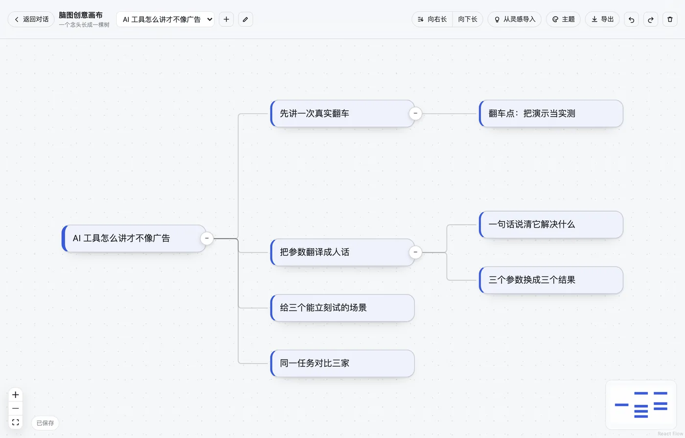
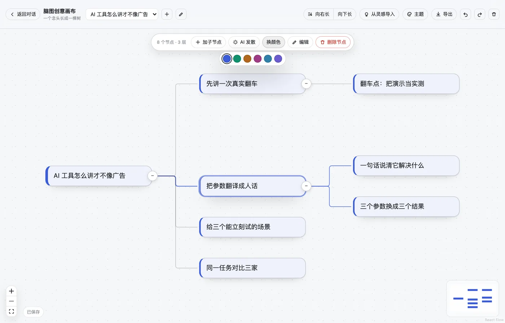
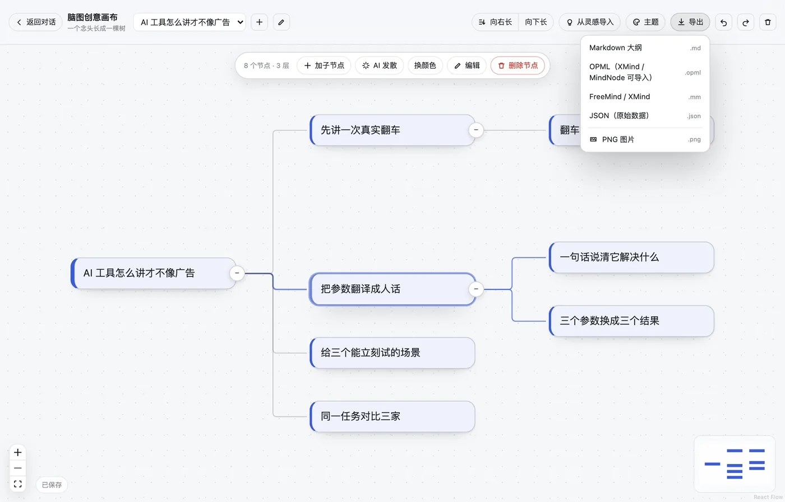
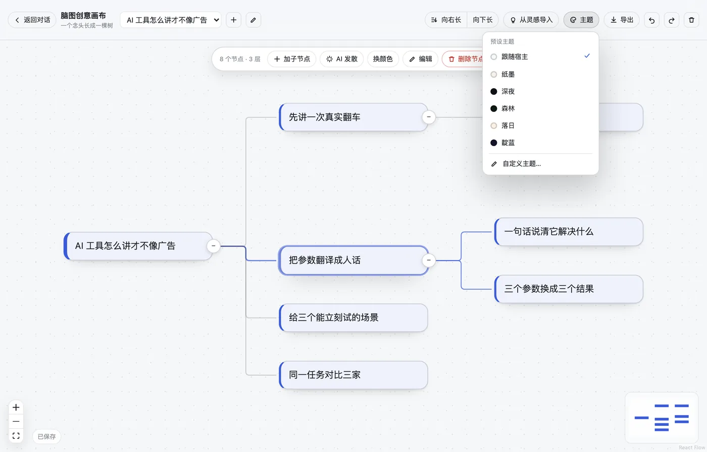
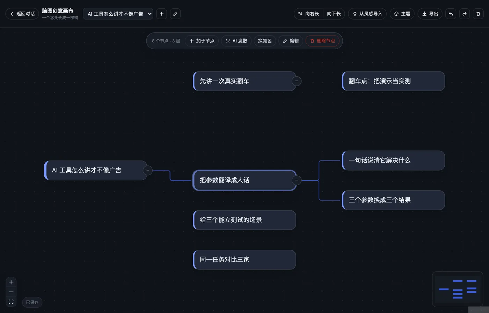
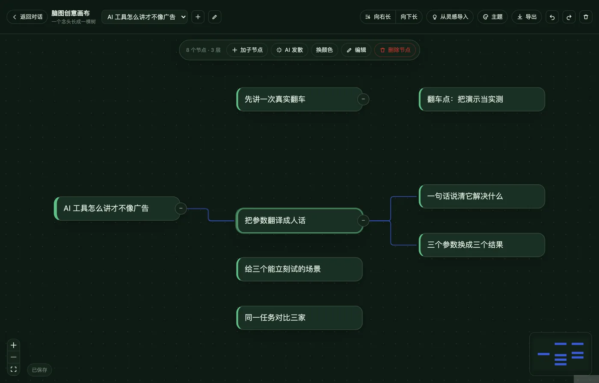

# 脑图创意画布 · dsh-mind-canvas

DeepSeek Harness 侧栏里的一个无限画布脑图。一句话起根，`Tab` 往右长，差不多了就一键整理成规整的树；可以顺手把自媒体工作台里的灵感拉进来当根节点，也可以让助手把一个节点 AI 发散成几条子想法，最后导出成 Markdown / OPML / FreeMind / JSON / PNG。



> 画布的相机和坐标思路来自 `dsh-media-desk` 的「灵感墙」——那里是一堆**散落的卡片**，没有层级；这里换成 `@xyflow/react` 的节点图 + `d3-hierarchy` 的 tidy tree，把「散落」变成「结构」。

## 能做什么

**像打字一样画脑图。** 空态输入框回车就是第一颗节点；`Tab` 加子节点并直接进入编辑，`Enter` 编辑，`⌫` 删整棵子树，`⌘Z` 撤销。选中节点后浮动工具栏给出加子节点、AI 发散、换颜色、编辑、删除。

**整理成树。** 用 `d3-hierarchy` 的 tidy tree 重排：父节点居中于子节点、同级不重叠、整体平移到原点附近。能向右长，也能向下长。

**颜色自选，不是随机。** 每张卡片 6 个色相，点哪个是哪个；左侧色条、卡片底色、缩略图同步。子节点默认继承父节点色相。

**主题：跟随宿主，或自己调。** 5 套预设（纸墨 / 深夜 / 森林 / 落日 / 靛蓝）+ 自定义 13 个颜色位。「跟随宿主」时一个颜色都不覆盖，完全继承应用明暗主题；14 组配色的对比度都过了 WCAG 4.5:1。

**导出真的能进别的工具。** Markdown 大纲、OPML 2.0（XMind / MindNode / 幕布可导入）、FreeMind `.mm`、原始 JSON（带坐标，可再导回）、PNG 图片。

**和自媒体工作台联动。** 「从灵感导入」只读 `~/.dsh/media-desk/state.json` 的标题级字段，把选中的灵感落成根节点；「AI 发散」用宿主当前默认模型给出 3–6 个具体子想法，没有可用模型时明确报错，不编数据。

## 语音输入（v0.3）

装了 [realtime-voice](../realtime-voice) 就能直接在画布里说话：

- 空态输入框旁、以及任何正在编辑的节点卡片右下角，都有一个麦克风按钮；
- 语音识别、自动排版、中→英翻译全交给 `voiceInput` 服务，画布只负责把文字插到当前光标处；
- 一句话说完先攒住，等下一句一起排版（realtime-voice 的连句校正），所以断句偏了也能被接回来；
- 没装 realtime-voice 时按钮不出现，画布行为与之前完全一致（可选依赖，不写死）。

接入方式是公开 API：`ctx.get('voiceInput')` → `attach({ id, captureInsertion, insertText })`，见 [realtime-voice 的 INTEGRATION.md](../realtime-voice/docs/INTEGRATION.md)。任何带输入框的插件都能照这个模式接。

## 截图

| 换颜色（6 色自选） | 导出（5 种格式） |
| --- | --- |
|  |  |

| 主题菜单 | 深夜主题 |
| --- | --- |
|  |  |

森林主题：



## 快捷键

| 操作 | 效果 |
| --- | --- |
| 中间输入框回车 / 双击空白 | 新建根节点（双击会落到那个位置） |
| `Tab` | 给选中节点加子节点，直接进入编辑 |
| `Enter` | 编辑选中节点 |
| `⌘/Ctrl + Enter` | 对选中节点 AI 发散 |
| `⌫` / `Delete` | 删除选中节点及其整棵子树 |
| `⌘/Ctrl + Z` / `Shift + ⌘/Ctrl + Z` | 撤销 / 重做 |
| `Esc` | 关弹层 → 退出编辑 → 取消选中 |
| 「向右长 / 向下长」 | tidy tree 重排 |

## 数据

一份 JSON 管所有脑图，存在 `$DSH_HOME/mind-canvas/state.json`：

```jsonc
{
  "version": 1,
  "activeId": "d_...",
  "revision": 12,
  "docs": [{
    "id": "d_...",
    "title": "AI 工具怎么讲才不像广告",
    "layout": "tree-right",
    "theme": { "preset": "auto" },        // 或 { preset:"custom", custom:{ bg:"#…", accent:"#…" } }
    "view": { "x": 120, "y": 80, "zoom": 0.9 },
    "nodes": [{
      "id": "n_...", "text": "先讲一次真实翻车",
      "parentId": "n_...", "x": 300, "y": 0,
      "tone": "a", "source": { "kind": "ai" }
    }]
  }]
}
```

写入是 tmp + rename 的原子替换，坏文件不会把好文件写坏；读到坏 JSON 会退回上一份能用的快照。宿主连不上时界面自动退到浏览器本地存储，并在左下角标出来，不白屏。

## 助手工具

装了插件之后，助手多两个工具：

- `mind_canvas_read` —— 把某张脑图读成 Markdown 大纲（带节点数 / 根数 / 层数）。
- `mind_canvas_add` —— 在某个节点下面加子节点（`parent` 用文字部分匹配，匹配不到就落到根上）。

于是「把这几个想法整理成一张脑图」可以直接在对话里做完，画布刷新即见。Markdown 大纲只有一份实现（`client-src/export.js`），界面导出、宿主工具和测试共用它。

## 技术选择

- **[@xyflow/react](https://reactflow.dev) 12.12.1**（MIT）：无限画布的平移 / 缩放 / 拖拽 / 连线 / fitView / MiniMap 都是现成的，节点是真 React 组件，卡片内联编辑和中文输入法都可控。
- **[d3-hierarchy](https://github.com/d3/d3-hierarchy) 3.1.2**（MIT）：`tree()` 的 tidy tree 负责「整理成树」。
- **html-to-image 1.11.13**（MIT）：只用来导出 PNG。
- 除 React / ReactDOM 走宿主 seed 模块表外，其余全打进 `client.js`（约 284KB，gzip 后 ~70KB）。
- 宿主半片**零运行时依赖**，只用 Node 内置模块 —— 少一个装不上的包就少一类启动失败。
- 主题不写死在 CSS 里：每个颜色都是 `var(--mc-*, var(--dsw-…))`，`theme.js` 只产出 `--mc-*` 覆盖。

## 安装

```bash
dsh plugin install "git+https://github.com/Feahter/dsh-plugins.git#<commit>&path:/plugins/mind-canvas"
```

或在 Harness 的 设置 → 插件 里指向这个目录。桌面端的实际情况（实测）：

- `dsh plugin add` 只跑 pnpm，**不会**把包追加进 `dsh.profile.bundles`，要手动加或走 设置 → 插件。
- 写进 bundles 并软链进 `~/.dsh/profiles/desktop/node_modules/` 之后，**宿主半片会被 loader 热加载** —— `mind_canvas_*` 工具和 `/mind-canvas` 路由当场就活。
- **浏览器半片要刷新一次页面**才出现；之后改 `client.js` 会被 client-hmr 在 500ms 内热替换。

## 开发

```bash
npm install
npm run build        # client-src/ → client.js（esbuild，套 __ModuleLoader__ 外壳）
npm test             # node --test：树逻辑、布局、存储、路由、工具、导出格式、主题
node dev/verify.mjs  # 真 Chromium 端到端：37 项断言 + 截图到 test/screens/
node dev/shots.mjs   # 生成 README 示意图到 /tmp/mc-shots/
```

`dev/` 是本地验证用的假宿主（模拟 `__ModuleLoader__`、seed 模块表和 Cordis ctx），不随包发布。

## License

MIT
