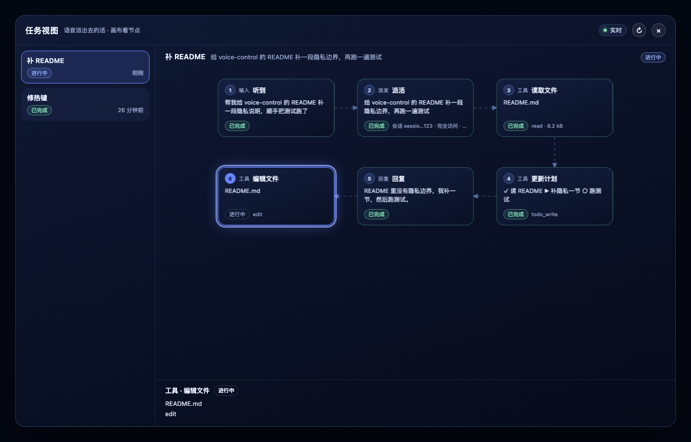

# 语音管家（voice-companion）v0.7

DSH 的「一个插件装完所有语音面」：**面板通话**、**输入框听写**、**全局热键指令**、**3D 看板**、**自由换肤**、**自定义形象**、**自定义声音**都在这里，不再需要另外两个插件。

v0.4 换了一张脸：默认形象是自研的 3D 科幻核心（不依赖 three.js、不加载贴图），整块看板的 **87 个样式 token** 全部可改，而且可以直接说一句话让模型改——「改成赛博朋克红黑，霓虹绿边框」——先预览，满意再存成自己的主题。同时把看板收窄回它唯一该做的事：**语音输入 + 把活派给 DSH**。

v0.3 带来的是：形象可以换成你自己的图、声音可以三槽自选并调语速、语音派出去的活默认拿完全权限 + high 推理。

原来拆成三个包，现在合了：

| 原来的包 | 现在 |
| --- | --- |
| `dsh-voice-companion`（面板通话） | 本插件主体 |
| `dsh-realtime-voice`（输入框听写） | `src/client/dictation.js` + `polish.js`，走面板上的「听写」模式 |
| `dsh-voice-control`（热键单句） | `src/client/hotkey.js`，Ctrl+Shift+Space 按住说话 |

## 热键与麦克风（先看这里）

- 热键 `Ctrl+Shift+Space` 只在 DSH 窗口有焦点时生效（可用 `localStorage['dsh.voice-companion.hotkey']` 改组合）；注册失败或组合被浏览器保留时，会自动试「加修饰键」的候选键，并把最终生效的组合写在面板提示里；候选都不可用时，面板出现「按住说话」按钮，功能不丢。
- 第一次开始通话前，面板会说明「为什么要麦克风」（只在本机识别，音频不出机器）；拒绝后提示 macOS「系统设置 → 隐私与安全性 → 麦克风」，面板、设置与历史仍可用。
- 权限拒绝不会被缓存：去系统设置打开后，再点一次「开始通话」就会重新请求，不用刷新页面。
- 宿主（Electron 桌面壳）目前自动批准权限请求；插件只能在收到拒绝后引导，真正的权限收紧仍需宿主侧 `setPermissionRequestHandler`。

## 安装

```bash
# 从插件市场（GUI 里 Discover）装，或手动：
dsh plugin install "git+https://github.com/Feahter/dsh-plugins.git#main&path:/plugins/voice-companion"

# 本地开发时用 link：
dsh plugin --profile desktop add link:$HOME/Documents/deepseek-harness/dsh-plugins/plugins/voice-companion
```

装完确认 profile 的 `package.json` 里 `dsh.profile.bundles` 含 `dsh-voice-companion`，然后重启 GUI（或 `dsh web`）。
语音识别依赖官方 **Voice input** 实验包（本地 SenseVoice + `speech` Host Remote），`/speak` 需要一个可用的 TTS provider。

## 三张嘴，一张脸

| 入口 | 怎么用 | 说什么 |
| --- | --- | --- |
| 面板「开始通话」 | 点一次，之后连续对话 | 聊天、派活、后台干完主动回来找你 |
| 面板「听写」模式 | 点一次，说一段，松口即落字 | 口述转文字，填词、去口水话后写进输入框 |
| `Ctrl+Shift+Space` | 全局按住说一句，松手执行 | 一句话路由：派活 / 回答 / 补写 |

三种入口共用同一个看板娘面板、同一套人格和同一套音色选择。

## 看板：默认是 3D 核心

v0.4 默认形象是**自研的 3D 科幻核心**（`src/client/core3d.js`）：一颗 SDF 光线步进的发光球体，外面套两个倾斜的轨道环，五态各有一套调色板与脉动参数（`idle` 蓝白呼吸 / `listening` 青绿扩散 / `thinking` 蓝紫收缩 / `speaking` 亮白随音量起伏 / `error` 暗红降饱和）。

- 渲染是手写 GLSL（WebGL2，40 步光线步进 + fresnel 边缘光 + 扫描线 + 体积辉光），帧耗时超过 22 ms 自动降到 24 步的 LITE 版本；没有 WebGL 时按 `webgl2 → webgl1 → canvas2d → 纯 CSS` 逐级降级，最低档仍是一个会呼吸的光球，不会白屏。
- **不依赖 three.js**：插件打包后的运行期只认 11 个平台模块，three 不在其中；也没有外部贴图、没有网络请求。
- 舞台 152 px 高，面板 340×316；拖动、贴边吸附（24 px 内吸到 12 px）、收起成 44×44 圆胶囊（胶囊里是核心的实时缩略）都还在。
- 老的鲸鱼/看板娘仍留在 `characters.js`，宿主 `/characters` 照旧返回它们（`whale`/`chibi`），只是客户端不再默认选它们：

| id | 名字 | 形象 | 默认音色 |
| --- | --- | --- | --- |
| `core` | 贾维斯 | 自研 3D 发光核心（**v0.4 默认**） | `tide`（男声） |
| `whale` | 大肥鱼 | 官方 Logo 的萌化胖鲸鱼（`#4D6BFE` 蓝身、白腹、大眼、喷水孔） | `tide`（男声） |
| `chibi` | 小肥鱼 | 二次元看板娘：蓝发、耳机、水手服、大眼睛 | `stella`（女声） |

- 后两个是**代码画的原创 SVG**（`src/client/characters.js`），不依赖任何外部贴图，没有版权问题，也不发网络请求。
- 五个状态都做了动画：`idle` 呼吸/眨眼/偶尔冒泡、`listening` 光晕与外圈波纹、`thinking` 眼睛上翻+三点、`speaking` 嘴随音量开合、`error` 灰化耷拉。
- 面板能拖：按住头顶那条（光标变抓手）拖到任意位置，松手记住；`localStorage['dsh.voice-companion.pos']` 存 `{left,top}`，`dsh.voice-companion.collapsed` 存收起状态。位置会夹在视口内，至少留一截可抓。
- 面板能收：右上「−」把整块折成一颗 44×44 的圆胶囊，里面是 3D 核心的缩略 + 状态色，点胶囊展开；收起时不影响通话和热键。
- 自查页：`assets/avatar-demo.html`（直接 `open` 就行，`?character=chibi` 换形象）。截图：`assets/screenshot-whale.png`、`assets/screenshot-chibi.png`。

### 换成你自己的形象

形象 chip 最右边的「＋」选一张本地图片（png/jpeg/webp/gif），插件在浏览器里把它缩到最长边 512 px、转成 webp 存进 `localStorage['dsh.voice-companion.face']`（`{name, src}`，`src` 必须 `data:image/` 开头，原始文件超过 800 KB 直接拒收）。存下之后：

- 舞台上渲染的是 ``（`buildCustomFace`），呼吸/摆动/换形象动画照旧；没有嘴巴关节，所以 `speaking` 时不会开合。
- 名字可以改（齿轮 → 形象 → 输入框，最长 12 字）；不想要了点「移除自定义形象」，回落到默认那条鲸鱼，`localStorage` 里那条记录也一起删掉。
- 只有一张自定义形象；上传和缩放全在本地 `canvas` 里做，图片不出机器。

## 外观：一句话换皮肤

齿轮 → 抽屉底部的**外观**区。整块看板的样式被拆成 87 个 token、8 组（`board`/`type`/`text`/`accent`/`dot`/`button`/`stage`/`surface`），定义在 `src/client/theme.js` 的 `TOKEN_SCHEMA`；CSS 里写的是 `var(--vc-*, 原默认值)`，所以**不换主题时像素级和 v0.3 一样**。

| 能力 | 怎么用 |
| --- | --- |
| 换主题 | 「外观」里的胶囊列表，内置「默认」+ 你存的主题，点一下即时生效并记住 |
| 一句话改样式 | 输入「改成赛博朋克红黑，霓虹绿边框」→ 生成 → **先预览不落盘**，满意再点「保存主题」并命名 |
| 删主题 | 选中自己的主题点「删除」（内置默认不可删，删当前项自动回落默认） |
| 导出 | 把当前主题存成 `.json` 下载，可以发给别人 |
| 导入 | 选一个 `.json` 读进来，自动消毒后存为自定义主题（名字重复自动加 ` (2)`） |

- **主题库**存 `localStorage['dsh.voice-companion.themes']`（`{v:1, active, items:[{id,name,tokens,css,createdAt}]}`，上限 50 条），当前主题快照存 `dsh.voice-companion.theme.active`；JSON 损坏会先把原文另存到 `...themes.corrupt` 再重建空库，**不会因为一条坏数据把面板搞白**。
- **模型链路**：客户端 `POST /api/voice-companion/theme/design`，宿主用 `host/theme.js` 的 `SYSTEM_PROMPT`（全 token 键表 + 只准改样式不准改结构与脚本）调一轮模型，`maxTokens:900` / `temperature:0.35` / 20 s 超时，回来过两层 `sanitizeTheme`（宿主一层、客户端再一层），非法键进 `dropped` 不报错。限流 8 次/分钟 + 60 次/小时。
- 请求**必须带 `base`**（当前完整主题）：不带的话「边框再亮一点」这类相对指令模型没有参照物，会瞎猜一个颜色。实测带 base 时 `#39ff88 → #7dffb8` 正确变亮、字号整组 +1。
- 真上游实测（`deepseek-flash`）：「改成赛博朋克红黑，霓虹绿边框」→ 12 个 token + 1 条 css、`dropped` 为空、约 2.9 s、945/389 tokens；「边框再亮一点，字大一号」带 base → 1.2 s、`#7dffb8` + 字号 +1。
- 3D 核心的五个调色板也是 token（`core.palette.idle|listening|thinking|speaking|error`），改主题时核心颜色跟着变；`css` 那栏还能塞单条 CSS 补丁（如面板外发光），同样过白名单消毒。

## 音色

不是固定一个声音，按「谁说、说什么、说到第几句」自适应：

| 规则 | 效果 |
| --- | --- |
| 看板娘默认音色 | whale → `tide`（温柔），chibi → `stella`（明亮） |
| 情绪 | 句子里的歉疚词（抱歉/辛苦/别急…）早于兴奋词（！/哈哈/太棒…）→ 换 `.soft`，反之 `.bright`。whale 的 bright 借 `stella`，chibi 的 soft 借 `tide` |
| 轮次位置 | 一轮回答的第一句固定用 base，开场稳；第 2 句起逐句按情绪换 |
| 显式指定 | 请求里带 `voiceId` 就以它为准（`/speak`、`/turn` 都吃） |

`GET /api/voice-companion/characters` 返回可选形象和音色目录，面板与宿主读的是同一份表（`host/voice.js` 的 `CHARACTER_VOICES`）。

### 自己调声音

面板右上角的齿轮打开「声音与形象设置」：

| 控件 | 作用 |
| --- | --- |
| 基础声音 / 开心时 / 温柔时 | 三个槽分别指定 `stella`（明亮）或 `tide`（温柔）；只配一个槽也行，没配的槽回落到角色的默认映射 |
| 语速 | 0.75–1.35 倍。上游 TTS 没有语速参数，所以是浏览器播放时改 `playbackRate`——**会跟着改音高**，这是已知取舍 |
| 试听 | 用当前「基础声音」立刻合成一句试听，不动对话状态 |
| 保存 / 恢复默认 | 存 `localStorage['dsh.voice-companion.voice']`，下一句起生效（已合成的语气词会作废重合成） |

选择随每次 `/turn`、`/speak` 以 `voiceMap` 发给宿主，宿主过滤掉未知音色后按槽取用；一轮回答第一句仍固定用 base 槽。

## 用法

1. 点右下角面板的「开始通话」，浏览器请求麦克风权限。
2. 直接说话，例如「帮我把 voice-control 的 README 补一段隐私说明」。
3. 它先「嗯，我看一下」，然后把活派给后台 Session：「好，我去办，办完叫你」。
   - 派活前插件会把这个会话设成**完全访问权限**（`danger-full-access`：沙箱全开、审批 `never`）并把推理档拉到 **high**，所以语音派出去的活不用再回 GUI 点批准。新会话的 Agent 在 `agent/created` 事件里补设，老会话在 dispatch 时直接设。
4. 后台干完主动开口：「老板，README 补完了，加了隐私边界那一段」。
5. 想打断就继续说，检测到人声后停播，并把触发停播的 220 毫秒语音交给识别。
6. 点面板上的 ▦（任务视图）看画布：每个派出去的活是一条节点链，正在跑的那个节点会高亮，点节点看全文。
7. 再点「结束」挂断。麦克风意外断开时，面板会结束当前通话并给出重连提示。接回设备后，点「开始通话」重试。

挂断会中止本次通话中的 `/turn` 请求。宿主感知断连后，会在模型返回、创建会话、应用权限和推理默认值、提交任务等阶段之间检查取消。断连被宿主感知前，以及会话创建、权限切换或推理设置调用已启动时，仍可能留下对应副作用。已发出的模型、语音请求可能已被处理。任务一旦交给会话队列，仍按原有规则执行和追踪，即使挂断导致面板收不到派发回执。

调试入口：`__dshVoiceCompanion.openTasks()` 开任务画布、`.tasks()` 拉 `/tasks` 原始数据；`__dshVoiceCompanion.status()` / `.say('测试一下')` / `.start()` / `.stop()` / `.character('chibi')` / `.mode('dictation')` / `.voice()` / `.setVoice({map:{base:'tide'},speed:1.1})`。

## 架构

```
浏览器                                           宿主
┌────────────────────────────┐   HTTP 同源    ┌──────────────────────────────┐
│ 面板通话：能量 VAD + 断句    │ ────────────▶ │ /turn   人格 LLM → 句子数组   │
│ 输入框听写：整段转写 + 润色  │ ◀──────────── │ /speak  句子级 TTS + 缓存     │
│ 热键：按住录音 → 松手路由    │               │ /plan   一句话归到哪个动作    │
│ 看板娘 + 字幕 + 音色选择     │               │ /send   投递 / 回答           │
│ 任务画布：节点链 / 实时高亮  │ ◀──────────── │ /dispatch /events 后台任务    │
│                            │ ◀──────────── │ /tasks  任务列表 + 节点链     │
└────────────────────────────┘               │ /transcribe /characters       │
                                             └──────────────────────────────┘
```

- 识别在本机完成（DSH 自带 SenseVoiceSmall），音频不出机器。
- 合成走 `api.deepseek.com/v1/tools/tts`，**回复文本会出网**；key 只在宿主内存里读。
- 聊天走 `deepseek-flash`，一句回复通常 3–5 个短句。

## 路由

全部挂在 `/api/voice-companion` 下（`/plugins/*` 是 bundle 资产命名空间，页面打不到）。字段定义见 [`docs/protocol.md`](docs/protocol.md)。

| 方法 | 路径 | 作用 |
| --- | --- | --- |
| GET | `/health` | 服务、版本、当前看板娘、音色目录、ASR provider、在跟的任务数、派活默认设置（`tasks.defaults`） |
| GET | `/characters` | 可选形象（含默认音色）与音色目录 |
| POST | `/turn` | 一句话进来，回 `{reply, say[], voices[], task, kind}` |
| POST | `/speak` | 一句文本出去，回 base64 WAV（带 `voiceId`） |
| POST | `/plan` | 热键路径：一句话 → `{plan:{action:'ask'\|'new'\|'resume', sessionId?, candidates?}, confirmation}` |
| POST | `/send` | 热键路径：确认后真正执行（`prompt`/`new`/`cancel`，`resume` 由客户端翻成 `prompt`） |
| POST | `/dispatch` | 直接派活（`/turn` 判定为任务时内部也走它），派活前先设完全权限 + high 推理；可带 `utterance` 让画布第一格显示原话 |
| GET | `/events?since=` | 后台任务完成事件，游标语义 |
| GET | `/tasks` | 任务视图数据：不带 `taskId` 列出所有派过的活（新→旧，含状态/标题/原话）；带 `taskId=&live=1` 返回该任务的节点链（运行中每次读会话事件，已结束用结算快照） |
| POST | `/transcribe` | ASR 回退通路：base64 WAV → 本机 SenseVoice 文本 |
| POST | `/theme/design` | 一句话 → 模型 → 消毒后的主题补丁（`{utterance, base?, keep?}` → `{theme, changed, dropped, message, model, usage}`），限流 8/min + 60/h |

## 任务视图

面板右上角 ▦ 打开全屏画布（Esc / 右上 × 关闭），把一次语音派活的完整链路画成一条节点链：

```
听到 → 派活(权限/推理/会话) → 工具/回复的每一步 → 交付
```

- 节点状态：`active`（正在跑的那个，呼吸高亮 + 「进行中」）、`done`、`error`（红框）、`pending`（还没跑完但已经停下）。
- 运行中的任务每 1.6 秒刷新一次：宿主读会话事件里的 `tool/call`、`tool/result`、`assistant/message`，新的工具调用会把上一个节点标成 done，最后一个调用是 active；没有在飞的工具时补一个「下一步」节点。
- 任务结束（`agent/status` 变 idle 或 `agent/error`）时把节点链快照冻住，之后再打开不再读会话日志，历史记录不会被日志裁剪影响。
- 左栏是任务列表（新→旧，最多 50 条），点一条切过去；点节点在底部看完整内容。画布可拖动、滚轮缩放，切任务时自动对准 active 节点。


- 节点正文在宿主截到 1200 字、单次最多读 60 条会话事件；超长链路折叠中间节点成一个「省略」节点，画布不至于铺开几百格。

## 验收记录

**v0.7** 这批（任务视图）：

| 项 | 证据 |
| --- | --- |
| 单元测试 | `node --test "test/*.test.mjs"` **184/184 通过**（新增 `task-view.test.mjs` 13 条：节点构建、工具参数摘要、失败/长链折叠、列表与结算快照、`/tasks` 404；`taskview.test.mjs` 9 条：蛇形布局、连线、画布组件开合/切任务/点节点/缩放/空态） |
| 路由 | `host-companion.test.mjs` 33/33，新增 `GET /tasks` 列表 + 详情 + 404 的假宿主路由测试 |
| 客户端半片 | `test/client-harness.mjs` 107 条 ok（构建产物含 `taskview.js`，`__test` 不与 avatar 冲突） |
| 看板娘 / 热键 | `test/avatar-harness.mjs` 26/26、`test/hotkey-harness.mjs` 18/18 |
| 打包 | `client.js` **285,193 B**，12 个片段（`taskview.js` 在 `avatar.js` 之后、`index.js` 之前） |

**没验的**：任务画布没在运行中的 GUI 上点过（新宿主代码要重载插件才进内存）；真浏览器里拖动/缩放手感、和面板的层级关系只能人眼确认；「正在跑」的粒度来自会话事件聚合，不是宿主原生的 step 事件，模型长时间不产生事件时会停在最后一个工具节点。

**v0.6** 这批（挂断中止、打断识别、断连提示、设置面板分组）：

| 项 | 证据 |
| --- | --- |
| 单元测试 | `npm test` **161/161 通过**（含 `/turn` 的 AbortSignal 贯穿、设置面板分组、断连错误码） |
| 客户端半片 | `test/client-harness.mjs` **107 条 ok**（新增：人声打断把那 220 毫秒语音交给识别、麦克风意外断开结束通话并给重连文案、挂断中止正在进行的 `/turn`、过期页面不再追加） |
| 看板娘 / 热键 | `test/avatar-harness.mjs` **26/26**、`test/hotkey-harness.mjs` **18/18** |

**v0.4** 这批：

| 项 | 证据 |
| --- | --- |
| 单元测试 | `npm test` **153/153 通过** = v0.3 的 112 条 + `core3d` 13 + `theme` 11 + `theme-store` 15 + 2 条回归（history `text` 兼容、cancel 缺 sessionId 走 404） |
| 构建产物 | `client.js` **232,338 B**（v0.3 是 171,098），gzip **60,760 B**；11 个片段，`theme.js`/`theme-store.js`/`core3d.js` 各自行首 export、按 PARTS 顺序拼接 |
| 客户端半片 | `test/client-harness.mjs` **23/23 checks + 15 passed**，其中两条断言按 v0.4 契约改写（`stage starts on the core`、`no builtin chip is pressed while the core renders`——默认形象从鲸鱼换成 3D 核心是产品决定，不是测试迁就） |
| 看板娘 | `test/avatar-harness.mjs` **23/23**（含抽屉、槽位、改名、移除自定义形象） |
| 3D 核心 | `test/core3d.test.mjs` **13/13**（后端选择五分支、环投影数值、五态、canvas2d 兜底、着色器编译失败回落、无 DOM 惰性、rAF 缺失走 setTimeout、清理幂等）；真 Chrome headless（SwiftShader）跑出 `kind=webgl2` |
| 主题引擎 | 零 diff 校验：87 个 `var(--vc-*, fallback)` 里 86 个 fallback 与 v0.3 字面量逐字相同，剩下一个是新增的 `stage-bg: transparent`（不产生像素变化） |
| 模型链路 | `test/theme.test.mjs` **11/11**（全假 fetch：围栏解析、非法键、空补丁、上游 500、超时、限流 429、无 key 503、输入校验 400 且不耗配额）；另有**真上游联调**两次，见上面「外观」章节 |
| 视觉 | 真 Chrome headless 截图：默认 3D 待命态、listening 绿态、赛博主题（霓虹绿边框 + 红核心，证明 token 贯通到 3D）、44×44 收起胶囊、外观抽屉 |

v0.1 那批（真接口 curl）见 git 历史。v0.2 的旧数字见下；**v0.3** 这批：

| 项 | 证据 |
| --- | --- |
| 单元测试 | `node --test "test/*.test.mjs"` **112/112 通过**（新增 `test/task-defaults.test.mjs` 9 条：完全权限 preset、high 推理、max 回退、空 efforts 仍试 high、按 sandbox 找 preset、幂等、服务缺失不阻塞、`agent/created` 只对 tracked 会话生效、失败只 warn） |
| 构建后的客户端半片 | `test/client-harness.mjs` **45/45**（新增：齿轮开抽屉、三个槽有选项、语速文案、保存回传 profile、试听按选中的音色请求 `/speak`、恢复默认、再点关抽屉——全部跑在 `client.js` 这个构建产物上，不是源码） |
| 看板娘 | `test/avatar-harness.mjs` **23/23**（新增抽屉开合、槽初值、重开回落、试听/恢复默认 payload、Esc 关闭、改名与移除自定义形象） |
| 热键 | `test/hotkey-harness.mjs` 15/15 |
| 打包 | `node scripts/build-client.mjs` → `client.js` 168,004 B，8 个片段（`voice-profile.js` 在 `avatar.js` 之前） |

旧数字（v0.2）：宿主 22、路由 19、指令 11、音色 16、润色 14；客户端 33/33；看板娘 14/14。

**没验的**：宿主 9 条路由还没在运行中的 app 上 curl 过（新代码要重载插件/重启 GUI 才进内存）；真浏览器里的麦克风授权、自动播放策略、真实出声、拖动抽屉的视觉只能人耳人眼确认；`agent/created` 的真实时序只在宿主代码里核对过，用假 ctx 验证了处理逻辑，没有真实会话端到端验证。

| 项 | 证据 |
| --- | --- |
| 单元测试 | `node --test "test/*.test.mjs"` **92/92 通过**（宿主 22、路由 19、指令 11、音色 16、润色 14、其余 harness） |
| 客户端半片 | `test/client-harness.mjs` **33/33**：两个形象 chip、切换后 `data-character`/字幕/`/speak` 带 character、对话↔听写按钮、听写模式不再开 `/turn` |
| 热键 | `test/hotkey-harness.mjs` 15/15（假麦克风/假时钟/假 requestJson） |
| 看板娘 | `test/avatar-harness.mjs` 14/14（含拖动改位+落盘、按 chip 不触发拖动、收起胶囊+点开、第二个实例恢复位置）；真实 Chrome 截图 `assets/screenshot-whale.png` / `screenshot-chibi.png` |
| 打包 | `node scripts/build-client.mjs` → `client.js` 125,875 B，7 个片段拼成一个 ModuleLoader factory |

**没验的**：宿主 9 条路由还没在运行中的 app 上 curl 过（新代码要重载插件/重启 GUI 才进内存）；真浏览器里的麦克风授权、自动播放策略、真实出声只能人耳确认。

## 开发

```bash
node scripts/build-client.mjs     # src/client/*.js → client.js（ModuleLoader 形态）
node --test "test/*.test.mjs"     # 宿主 + 纯函数单测
node test/client-harness.mjs      # 客户端半片（假 DOM）
node test/avatar-harness.mjs      # 看板娘渲染
open assets/avatar-demo.html      # 形象自查页
```

改完代码让运行中的 app 生效：`plugin_manager` 里对 `include:dsh-voice-companion` 先 disable 再 enable，然后刷新页面重挂面板。

## 已知限制

- 断句靠能量阈值，环境噪音大时会提早断句；阈值在 `src/client/audio.js` 里自适应校准。
- 首句出声约 0.9–1.3 s，已用预合成语气词填补前 0.9 s。
- TTS 目录只有两个音色：`stella`（明亮）/ `tide`（温柔），`/health` 和 `/characters` 都能看到。上游只认这两个 id、没有语速/音高/克隆参数，所以「自定义声音」是选槽 + 客户端变速，不是真音色克隆；想加音色只能改 `host/voice.js` 的 `VOICE_CATALOG` 与 `CHARACTER_VOICES`（前提是上游真支持新 id）。
- 看板娘是 SVG 程序化绘制，细节不如贴图丰富；加新形象只需在 `characters.js` 里加一个 `build()` 与 `CHARACTERS` 条目。
- 后台任务完成事件依赖 `agent/status`；Session 被别的客户端取消时走 `task-failed` 分支。
- 任务画布的任务记录只存在宿主内存里：插件重载 / GUI 重启后清空，已结算的快照不落盘。
- 「正在跑」的节点靠会话事件推断：模型在两个工具调用之间长时间思考时，画布停在最后一个工具节点，不会显示逐 token 的进度。
- **没有 WebGL 的机器**（远程桌面、禁用硬件加速）会退到 Canvas2D 版核心：观感是发光球 + 两个环，没有体积辉光和立体光照；再退一档是纯 CSS 渐变球。降级是自动的，`/health` 不报告当前后端。
- **模型改样式不保证每次都合心意**：它只输出 token 补丁，不能改布局结构与脚本，输出为空时宿主回 502 `model-empty-patch`；一句话改不理想时最多再改两轮（限流 8/min），别指望它一次做出一整套设计系统。
